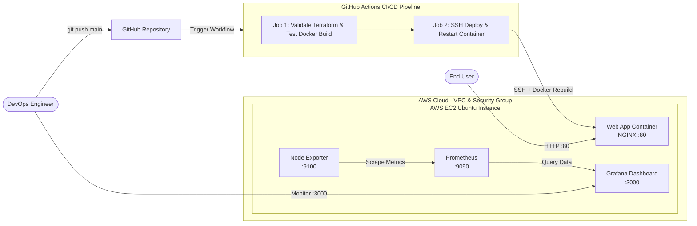
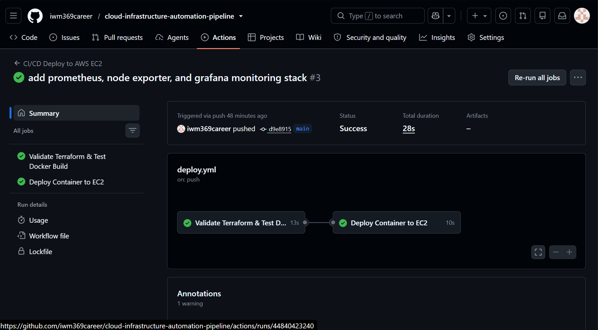
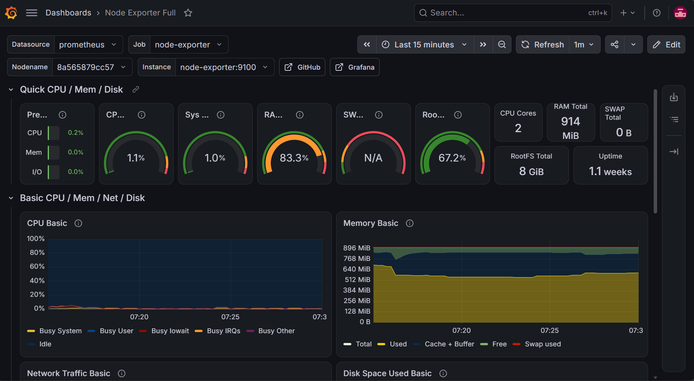

# Automated Web Infrastructure & CI/CD Pipeline


## Project Overview

Manual server provisioning and application deployment are slow, error-prone, and difficult to reproduce consistently across environments. This project implements an **end-to-end automated cloud infrastructure and CI/CD pipeline** on AWS.

Every push to the `main` branch automatically validates Infrastructure-as-Code (Terraform), verifies container builds (Docker), deploys the updated containerized web application to an AWS EC2 instance via GitHub Actions, and exposes real-time system telemetry through Prometheus, Node Exporter, and Grafana.

---

## Architecture Diagram



---

## Tech Stack

| Category | Technology | Purpose |
| :--- | :--- | :--- |
| **Cloud Provider** | AWS (EC2, VPC, Security Groups) | Compute and network isolation |
| **Infrastructure as Code** | Terraform | Declarative, reproducible cloud provisioning |
| **Containerization** | Docker & Docker Compose | Lightweight packaging for web app and monitoring stack |
| **CI/CD Automation** | GitHub Actions | Automated linting, build verification, and zero-touch deployment |
| **Observability** | Prometheus, Node Exporter, Grafana | Real-time CPU, memory, disk, and network telemetry |
| **Operating System** | Ubuntu Server (Linux) | Production host environment |

---

## Repository Structure

```text
├── .github/
│   └── workflows/
│       └── deploy.yml          # CI/CD pipeline definition (lint, build, SSH deploy)
├── app/
│   ├── Dockerfile              # Lightweight NGINX Alpine container image
│   └── index.html              # Static web application source
├── assets/
│   ├── github-actions-pipeline.png  # Proof of work: CI/CD pipeline execution
│   └── grafana-monitoring.png       # Proof of work: Grafana server metrics
├── monitoring/
│   ├── docker-compose.yml      # Multi-container monitoring stack (Prometheus, Grafana, Node Exporter)
│   └── prometheus.yml          # Scrape configuration for host metrics
├── terraform/
│   └── main.tf                 # AWS VPC, Security Group (ports 22, 80, 443, 3000), and EC2 provisioning
└── README.md                   # Project documentation
```

---

## How to Reproduce

### Prerequisites
* An active **AWS Account** with IAM credentials configured locally (`aws configure`)
* **Terraform** (`>= 1.5.0`) and **Git** installed on your local machine
* An **AWS EC2 Key Pair** (`.pem`) for SSH access

### Step 1: Clone the Repository
```bash
git clone [https://github.com/iwm369career/cloud-infrastructure-automation-pipeline.git](https://github.com/iwm369career/cloud-infrastructure-automation-pipeline.git)
cd cloud-infrastructure-automation-pipeline
```

### Step 2: Provision Infrastructure with Terraform
Initialize Terraform and deploy the AWS networking and EC2 resources:
```bash
cd terraform
terraform init
terraform plan
terraform apply -auto-approve
```
Note the **Public IPv4 address** of the provisioned EC2 instance from the AWS Console or Terraform output.

### Step 3: Configure GitHub Secrets & Trigger CI/CD
In your GitHub repository, navigate to **Settings $\rightarrow$ Secrets and variables $\rightarrow$ Actions** and add:
* `EC2_HOST`: Public IP address of your EC2 instance
* `EC2_USER`: `ubuntu`
* `EC2_SSH_KEY`: Full contents of your `.pem` private key file

Push any commit to `main` to trigger automatic deployment. Once completed, open `http://<EC2_PUBLIC_IP>` in your browser to verify the live web application.

### Step 4: Start the Observability Stack
Connect to the EC2 instance via SSH and launch the monitoring containers:
```bash
ssh -i "your-key.pem" ubuntu@<EC2_PUBLIC_IP>
cd ~/cloud-infrastructure-automation-pipeline/monitoring
sudo docker compose up -d
```
Access Grafana at `http://<EC2_PUBLIC_IP>:3000` (default credentials: `admin` / `admin`), add `http://prometheus:9090` as a Prometheus data source, and import **Dashboard ID `1860`** (*Node Exporter Full*).

---

## Proof of Work

### 1. Automated CI/CD Pipeline (GitHub Actions)
Every push to `main` validates Terraform formatting, tests the Docker build, and deploys the updated container onto AWS EC2:



### 2. Real-Time Server Observability (Grafana + Prometheus)
Host-level metrics (CPU utilization, RAM usage, disk I/O, and network traffic) collected by Node Exporter, scraped by Prometheus, and visualized in Grafana:



---

## Key Engineering Decisions

* **Immutable Infrastructure with Terraform:** Defining VPC rules, Security Groups, and EC2 instances in code eliminates manual configuration drift and allows the entire environment to be torn down and recreated in minutes.
* **Minimalist Container Footprint:** Built the web application on `nginx:alpine` to keep image sizes small, accelerate CI/CD build times, and minimize the attack surface.
* **Decoupled Observability Stack:** Isolated Prometheus, Node Exporter, and Grafana in a dedicated `docker-compose.yml` stack so monitoring remains operational independently of application container restarts.